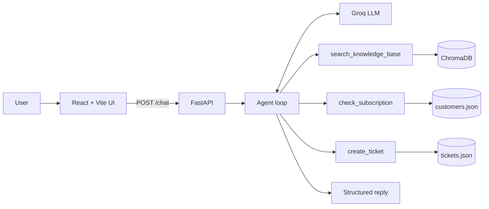

# Edith: AI Customer Support Agent


[](https://customer-support-agent-7pca.vercel.app/)

Edith is a customer support agent that answers questions from real help-center articles, remembers the conversation, looks up customer accounts, opens support tickets, and hands the conversation to a human when it cannot help.

It is a full-stack project: a Python backend (FastAPI, LangChain, Groq, ChromaDB) and a React frontend with animated chat, source links, and light/dark themes.

## Live Demo

**Try it here: [customer-support-agent-7pca.vercel.app](https://customer-support-agent-7pca.vercel.app/)**

| Part | Hosted on |
|---|---|
| Frontend (React + Vite) | Vercel |
| Backend (FastAPI + LangChain + ChromaDB) | Render |

> **Note:** The backend runs on a free Render instance that sleeps when idle. The first message after a quiet period can take up to a minute while the server wakes up. After that, replies are fast.

To explore the account and escalation features, try these fictional demo accounts: `ali@example.com` (Pro), `sara@example.com` (Max), `john@example.com` (Free), `mona@example.com` (Pro, payment failed). See [Try it](#try-it) for sample messages.

<!-- Add a screenshot: save it as docs/screenshot.png, then uncomment the next line -->
<!--  -->

## Table of Contents

- [Features](#features)
- [Architecture](#architecture)
- [Tech stack](#tech-stack)
- [Project structure](#project-structure)
- [Getting started](#getting-started)
- [Configuration](#configuration)
- [Knowledge base](#knowledge-base)
- [API reference](#api-reference)
- [Try it](#try-it)
- [Deployment](#deployment)
- [How the code maps to the concepts](#how-the-code-maps-to-the-concepts)
- [Known limitations](#known-limitations)
- [Roadmap](#roadmap)
- [Author](#author)
- [License](#license)

## Features

- **Retrieval-Augmented Generation (RAG):** answers are grounded in help-center articles stored in a vector database, and every answer links the articles it used.
- **Tool calling:** the model decides when to search the knowledge base, look up a subscription, or create a ticket.
- **Structured output:** every reply is validated with Pydantic and returns an answer, a category, and a `needs_human` flag.
- **Human escalation:** when Edith cannot find an answer, or the customer is upset or asks for a person, she opens a ticket and flags the conversation.
- **Conversation memory:** each `session_id` keeps its own recent chat history.
- **Modern UI:** React, Vite, and the `motion` animation library, with a live details panel, typing indicator, and a dark mode toggle.
- **Deployable:** runs locally, in Docker, or on Render (backend) and Vercel (frontend).

## Architecture



**How a message flows**

1. The UI sends `{ session_id, message }` to `POST /chat`.
2. The agent loop sends the conversation to the Groq model, which can request tool calls.
3. Tools run (vector search, account lookup, ticket creation) and return results to the model. This repeats for up to five rounds.
4. A final call forces the answer into the `SupportReply` schema.
5. The API returns the reply together with the source URLs collected from the search tool.

## Tech stack

| Layer | Technology |
|---|---|
| Language model | Groq (Llama 3.3 70B by default) |
| Orchestration | LangChain (tool calling, text splitting, document loaders) |
| Vector database | ChromaDB (persistent, local) |
| Embeddings | all-MiniLM-L6-v2 via ONNX (CPU only, no PyTorch) |
| Validation and settings | Pydantic, pydantic-settings |
| API | FastAPI, Uvicorn |
| Frontend | React, Vite, motion |
| Hosting | Render (backend), Vercel (frontend) |

## Project structure

```
.
├── app/
│   ├── agent.py          # agent loop, memory, structured reply
│   ├── config.py         # settings loaded from .env
│   ├── ingest.py         # load, clean, chunk, and store articles
│   ├── llm.py            # Groq model setup
│   ├── main.py           # FastAPI app
│   ├── schemas.py        # Pydantic models
│   ├── tools.py          # search, subscription lookup, ticket creation
│   └── vectorstore.py    # embeddings and ChromaDB
├── data/
│   ├── articles/         # optional local .md articles
│   ├── customers.json    # fictional demo customers
│   └── urls.txt          # help-center article URLs to ingest
├── frontend/
│   ├── src/
│   │   ├── components/   # Welcome, Message, Typing, Composer, Panel, ThemeToggle
│   │   ├── App.jsx
│   │   ├── api.js
│   │   ├── index.css
│   │   └── utils.js
│   ├── index.html
│   └── vite.config.js
├── chat_cli.py           # terminal chat for quick testing
├── Dockerfile
├── requirements.txt
└── .env.example
```

## Getting started

### Prerequisites

- Python 3.11 or newer
- Node.js 20.19 or newer
- A free [Groq API key](https://console.groq.com)

### 1. Backend

```bash
git clone https://github.com/Fahadqureshi0/Customer-Support-Agent.git
cd Customer-Support-Agent

python -m venv venv
source venv/bin/activate          # Windows: venv\Scripts\activate
pip install -r requirements.txt

cp .env.example .env              # Windows: copy .env.example .env
# open .env and set GROQ_API_KEY
```

Load the knowledge base into the vector database (run once, and again whenever you change `data/urls.txt`):

```bash
python -m app.ingest
```

Start the API:

```bash
uvicorn app.main:app --reload
```

The API runs at `http://127.0.0.1:8000`, and interactive docs are at `http://127.0.0.1:8000/docs`.

To chat in the terminal instead:

```bash
python chat_cli.py
```

### 2. Frontend

In a second terminal:

```bash
cd frontend
npm install
npm run dev
```

Open `http://localhost:5173`. The Vite dev server proxies `/chat` to the backend on port 8000, so no CORS setup is needed in development.

## Configuration

Set these in `.env`:

| Variable | Required | Default | Description |
|---|---|---|---|
| `GROQ_API_KEY` | Yes | none | Your Groq API key |
| `MODEL_NAME` | No | `llama-3.3-70b-versatile` | Groq model to use. If it is retired, pick a current model from Groq's model list. |
| `AGENT_NAME` | No | `Aria` | Name the agent uses for itself. This project uses `Edith`. |
| `COMPANY_NAME` | No | `Claude (Anthropic)` | Company the agent says it supports |

## Knowledge base

Edith answers from the articles listed in `data/urls.txt`, one URL per line (lines starting with `#` are ignored). You can also drop your own `.md` files into `data/articles/`.

```bash
# after editing data/urls.txt
python -m app.ingest
```

Ingestion loads each page, cleans the text, splits it into 800-character chunks with 100 characters of overlap, and stores the embeddings in `chroma_db/`. The source URL is kept as metadata so answers can cite it.

Use only content you are allowed to use, and follow each site's terms of service. The raw article text is not redistributed in this repository.

## API reference

### `POST /chat`

Request:

```json
{
  "session_id": "user-1",
  "message": "What are the usage limits on the Pro plan?"
}
```

Response:

```json
{
  "answer": "Usage on the Pro plan depends on message length and current demand...",
  "category": "usage",
  "needs_human": false,
  "agent": "Edith",
  "sources": [
    "https://support.claude.com/en/articles/8324991-about-claude-s-pro-plan-usage"
  ]
}
```

| Field | Type | Description |
|---|---|---|
| `answer` | string | The reply to show the customer |
| `category` | string | One of `billing`, `account`, `usage`, `technical`, `other` |
| `needs_human` | boolean | `true` when a human agent should take over |
| `agent` | string | The agent's name |
| `sources` | string[] | Help-center articles used for the answer |

Use the same `session_id` across requests to keep the conversation context.

### `GET /health`

Returns `{ "status": "ok", "agent": "Edith" }`. Useful for uptime checks and for waking a sleeping free-tier server.

## Try it

You can run these on the [live demo](https://customer-support-agent-7pca.vercel.app/) or locally.

| Message | What it demonstrates |
|---|---|
| "What are the usage limits on the Pro plan?" | RAG with source links |
| "What is the difference between usage limits and length limits?" | Retrieval across articles |
| "What's my plan? My email is mona@example.com" | `check_subscription` tool |
| "I want to talk to a human. My email is ali@example.com" | `create_ticket` tool and escalation |

Demo accounts (fictional): `ali@example.com` (Pro), `sara@example.com` (Max), `john@example.com` (Free), `mona@example.com` (Pro, payment failed).

## Deployment

The live demo uses the setup below: the backend on Render and the frontend on Vercel.

### Backend on Render

Create a **Web Service** from the repository with the Root Directory left empty:

| Setting | Value |
|---|---|
| Build Command | `pip install -r requirements.txt && python -m app.ingest` |
| Start Command | `uvicorn app.main:app --host 0.0.0.0 --port $PORT` |
| Environment | `GROQ_API_KEY`, `AGENT_NAME=Edith`, `PYTHON_VERSION=3.12.7` |

Set `GROQ_API_KEY` before the first build, because ingestion loads the settings. Free instances sleep when idle, so the first request after a pause can take up to a minute.

### Frontend on Vercel

Import the repository with **Root Directory** set to `frontend` and the Vite preset. Add `frontend/vercel.json` to forward chat requests to the backend:

```json
{
  "rewrites": [
    { "source": "/chat", "destination": "https://YOUR-SERVICE.onrender.com/chat" }
  ]
}
```

### Docker

```bash
python -m app.ingest
docker build -t edith .
docker run --env-file .env -p 8000:8000 -v "$(pwd)/chroma_db:/code/chroma_db" edith
```

## How the code maps to the concepts

| File | Concept |
|---|---|
| `app/config.py` | Pydantic settings and environment validation |
| `app/schemas.py` | Pydantic models and structured output |
| `app/llm.py` | LLM setup and temperature |
| `app/ingest.py` | Document loaders and chunking |
| `app/vectorstore.py` | Embeddings and the vector database |
| `app/tools.py` | Tools the model can call |
| `app/agent.py` | Agent loop, memory, and escalation |
| `app/main.py` | REST API with FastAPI |
| `frontend/src/` | Chat UI, API calls, animation, theming |

## Known limitations

- Conversation memory lives in server RAM, so it resets on restart and does not scale across multiple instances.
- `check_subscription` trusts the email address it is given. A real system needs authentication before showing account data.
- Customer and ticket data are local JSON files, not a real database or helpdesk. On free hosting, tickets are lost when the server redeploys.
- Answers are only as current as the last ingestion run.
- There is no automated evaluation set yet, so answer quality is checked by hand.
- The free-tier backend sleeps when idle, so the first request can be slow.

## Roadmap

- [ ] Persist sessions and tickets in Redis or PostgreSQL
- [ ] Authenticate customers before account lookups
- [ ] Stream responses token by token
- [ ] Add an evaluation set to measure answer accuracy and citation quality
- [ ] Add rate limiting and basic abuse protection
- [ ] Collect thumbs-up and thumbs-down feedback on answers

## Author

**Fahad Qureshi**
GitHub: [Fahadqureshi0](https://github.com/Fahadqureshi0) · LinkedIn: [fahad-qureshi](https://www.linkedin.com/in/fahad-qureshi-b85664444/)

## License

See the [LICENSE](LICENSE) file.
